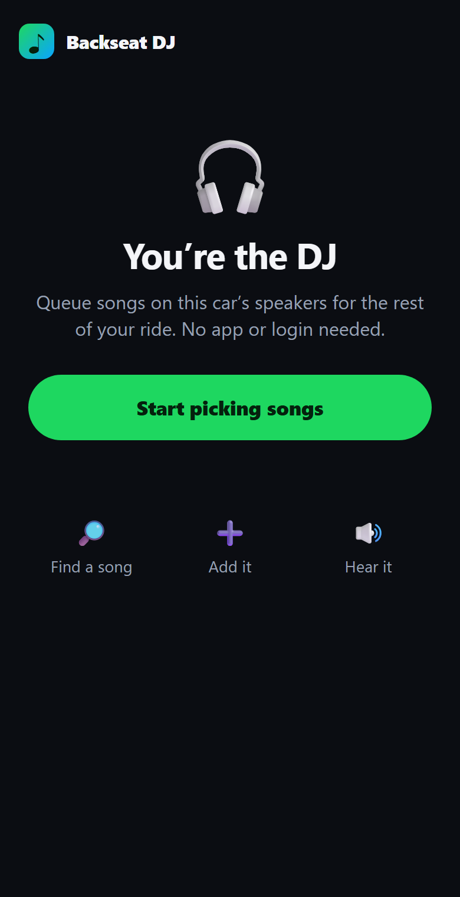
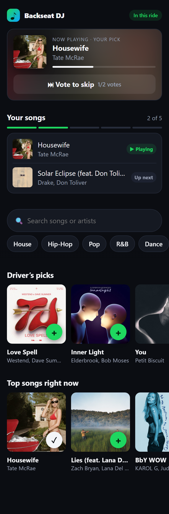
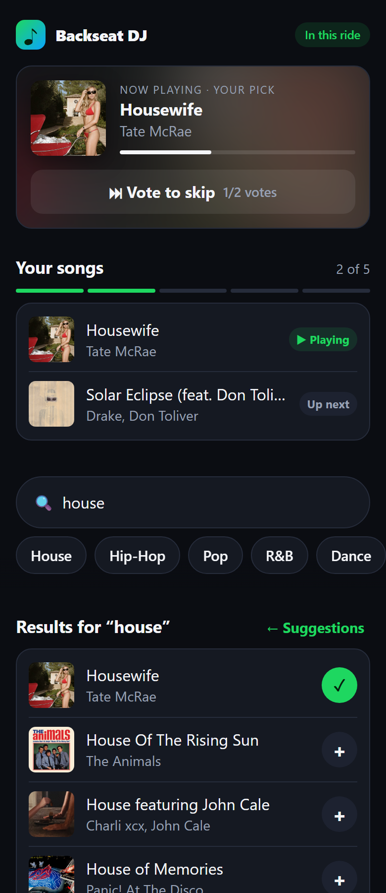
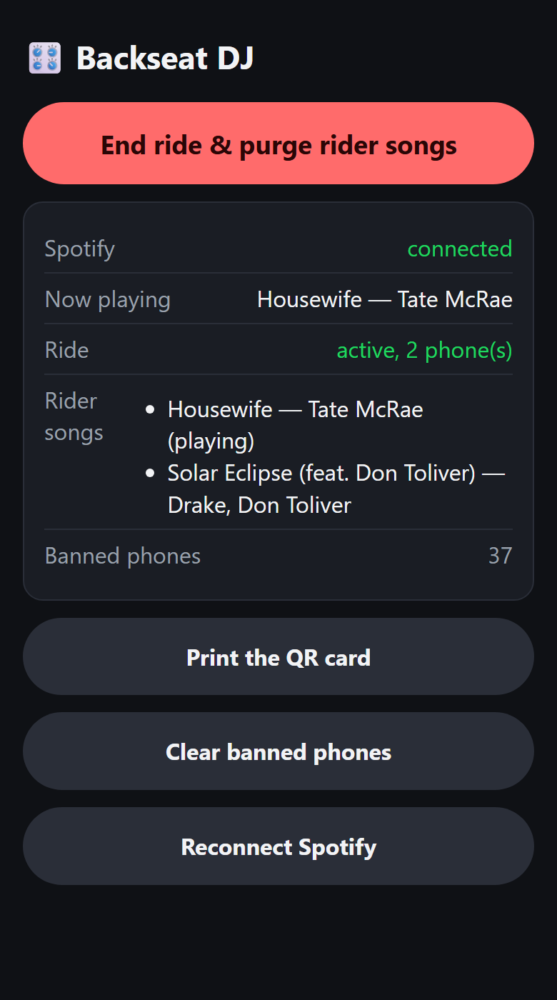
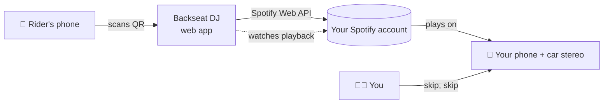

<div align="center">

# 🎧 Backseat DJ

**Let your passengers pick the music, without handing them your phone.**

Riders scan a QR code, search Spotify, and queue songs on the car's speakers.
When the ride's over, you skip twice from the steering wheel and they're out.


&nbsp;&nbsp;
&nbsp;&nbsp;


</div>

---

## Why

Rideshare and taxi drivers keep their phone mounted for navigation, so passengers can't touch the music, and handing over your phone isn't happening. Spotify Jams need everyone on Spotify and give guests full control with no way to cut them off. Backseat DJ is a small self-hosted web app that sits between your passengers and your Spotify:

- **No app or login for riders.** They scan, tap *Start picking songs*, and go.
- **You stay in control.** Riders get a few songs in the queue, never your account.
- **Hands-free ending.** Double-skip from the steering wheel ends the ride, kicks everyone out, and skips any of their songs that are still queued.

## Features

| For riders | For the driver |
|---|---|
| 🔎 Search all of Spotify | ⏭⏭ **Double-skip to end the ride**, no phone needed |
| 🎛 Genre buttons (House, Hip-Hop, 90s…) | 🚫 Phones from ended rides are **banned for good**, so an old photo of the QR code is useless |
| ⭐ *Driver's picks* (your top tracks) and *Top songs right now* (Apple Music US chart) | 🧹 Leftover rider songs are auto-skipped |
| ▶️ First song of the ride **plays immediately** | 🎚 Admin page: end ride, clear bans, print the QR card |
| 🗳 **Vote to skip** (majority of riders) | 🔒 Locked-down container, rate limits, no database |
| 📊 Queue meter: up to 5 songs waiting | 🏠 Runs on a NAS, Raspberry Pi, VPS, anything with Docker |

<p align="center"></p>

## How it works



Only **your** Spotify account is ever connected. The server watches what's playing every few seconds. Two manual skips within 20 seconds means the ride's over: every phone in the ride gets banned, and any of their songs still in the queue are skipped when they come up. Spotify has no "remove from queue" API, so skipping is the only way to drop them.

## Quick start

You'll need:
- **Spotify Premium.** Spotify requires it for apps like this one.
- **A machine with Docker** that stays on.
- **A public HTTPS address.** Riders are on cellular data. The [three options](#3-put-it-online) below include free ones.

### 1. Create a Spotify app

1. Go to the [Spotify Developer Dashboard](https://developer.spotify.com/dashboard) → **Create app**.
2. **Redirect URI:** `https://<your-public-address>/callback`. You can come back and edit this once you know the address.
3. **APIs used:** tick **Web API** only.
4. Open **Settings** and copy the **Client ID** and **Client secret**.

### 2. Configure

```sh
git clone https://github.com/<you>/backseat-dj.git
cd backseat-dj
cp .env.example .env
```

Fill in `.env`:

```ini
PUBLIC_URL=https://backseat-dj.your-tailnet.ts.net   # no trailing slash
SPOTIFY_CLIENT_ID=...
SPOTIFY_CLIENT_SECRET=...
ADMIN_PASSWORD=...        # openssl rand -base64 18
```

Paste values in plain, with no quotes.

### 3. Put it online

Pick **one** option:

<details open>
<summary><b>Option A: Tailscale Funnel</b> (free, no domain needed)</summary>

You get `https://backseat-dj.<your-tailnet>.ts.net`, served by a small Tailscale container included in the compose file.

1. In the [Tailscale admin console](https://login.tailscale.com/admin), go to **DNS** and pick a tailnet name. You can swap the random `tailXXXX` for a friendlier two-word one.
2. **Settings → Keys → Generate auth key.** Leave Reusable and Ephemeral off, and don't add tags.
3. Add to `.env`:
   ```ini
   COMPOSE_PROFILES=tailscale
   TS_AUTHKEY=tskey-auth-...
   PUBLIC_URL=https://backseat-dj.<your-tailnet>.ts.net
   ```
4. The first time Funnel starts, Tailscale may ask you to approve it for your tailnet. Follow the link in `docker logs backseat-dj-tailscale`.

</details>

<details>
<summary><b>Option B: Cloudflare Tunnel</b> (free, needs a domain on Cloudflare)</summary>

1. In Cloudflare **Zero Trust → Networks → Tunnels**, create a tunnel and copy its token.
2. Add a public hostname (e.g. `dj.example.com`) pointing to `http://backseat-dj:8080`.
3. Add to `.env`:
   ```ini
   COMPOSE_PROFILES=cloudflare
   CLOUDFLARE_TUNNEL_TOKEN=...
   PUBLIC_URL=https://dj.example.com
   ```

</details>

<details>
<summary><b>Option C: Your own reverse proxy</b> (Caddy, nginx, Traefik…)</summary>

The app listens on host port `8787` (change it with `HOST_PORT`). For example, with Caddy:

```caddy
dj.example.com {
    reverse_proxy localhost:8787
}
```

</details>

### 4. Start it

```sh
docker compose up -d --build
```

Open `https://<your-public-address>/admin`. Any username works; the password is your `ADMIN_PASSWORD`. Tap **Connect Spotify**.

> **Spotify says your account isn't registered?** Add your Spotify email under **User Management** in the developer dashboard.

### 5. Print the QR card

On `/admin`, tap **Print the QR card** and stick it on the back of a headrest. Adding `/admin` to your phone's home screen gives you one-tap *End ride* and *Clear bans* buttons.

## Using it

| You want to… | Do this |
|---|---|
| End a ride | Skip twice within 20 s (steering wheel, earbuds, or the phone) |
| End it from the phone instead | `/admin` → **End ride & purge rider songs** |
| Let a banned phone back in (e.g. testing on your own) | `/admin` → **Clear banned phones** |
| Change the song limit | `SONG_LIMIT=3` in `.env`, then `docker compose up -d` |

If nothing happens for 20 minutes and no rider songs are waiting, the ride ends on its own. That **doesn't** ban anyone, so a passenger who put their phone away can rejoin.

## Configuration

All settings live in `.env`:

| Variable | Default | |
|---|---|---|
| `PUBLIC_URL` | (required) | Public HTTPS address, no trailing slash |
| `SPOTIFY_CLIENT_ID` / `SPOTIFY_CLIENT_SECRET` | (required) | From your Spotify app |
| `ADMIN_PASSWORD` | (required) | Protects `/admin` |
| `SONG_LIMIT` | `5` | Songs a ride can have waiting at once |
| `DOUBLE_SKIP_WINDOW_SECONDS` | `20` | Two skips inside this window end the ride |
| `RIDE_IDLE_MINUTES` | `20` | End an idle ride with nothing queued (no ban) |
| `RIDE_MAX_MINUTES` | `180` | Hard cap on a ride |
| `HOST_PORT` | `8787` | Host port for a reverse proxy or local testing |
| `COMPOSE_PROFILES` | (none) | `tailscale` or `cloudflare` to start a tunnel container |

<details>
<summary><b>Running without Docker</b></summary>

```sh
npm install
export $(grep -v '^#' .env | xargs)   # or set the variables however you like
npm start                              # listens on :8080
```

Node 20 or newer. Spotify login and the ban list are saved in `./data` (set `DATA_DIR` to change it).

</details>

## Security

- **No database**, so there's no SQL to inject. The only things on disk are your Spotify login and a list of hashed phone IDs.
- **Riders can only queue songs the server itself returned** from a search or suggestion list. Search text is URL-encoded before it goes to Spotify. Everything on the page is rendered as plain text, so a song title can't run code in a rider's browser.
- **Rate limits** on join, search, queue and skip, per phone and overall, so nobody can burn through your Spotify API quota.
- **Strict security headers** (CSP, no framing, no sniffing). The admin page uses HTTP Basic auth with a constant-time password check, and wrong passwords are slowed down.
- **The container is read-only, runs as a non-root user, has no Linux capabilities, and has memory and process limits.** It can only write to its own data volume.

## Limitations

- **Personal, non-commercial use only.** Spotify's [Developer Policy](https://developer.spotify.com/policy/) doesn't allow selling, advertising in, or charging for apps built on Spotify playback. Run your own copy for your own car.
- **5 Spotify accounts max.** Spotify's development mode allows 5 authorized users per app. That's fine here, because only the driver logs in.
- **10 search results max.** That's Spotify's development-mode cap.
- **Your own double-skip also ends the ride.** Skipping two of *your own* songs within 20 seconds counts too. Clear the bans if that catches a passenger who's still in the car.
- **The ban isn't airtight.** A determined rider can get around it by clearing their browser data. The most they can do is queue a few songs before you skip them.

## Development

```sh
npm install
npm test     # node --test
```

| File | |
|---|---|
| `src/server.js` | HTTP routes, auth, rate limits, headers |
| `src/ride.js` | Rides, rider songs, bans, vote-skip |
| `src/watcher.js` | Polls Spotify, detects the double-skip, purges leftovers |
| `src/skips.js` | Counts manual skips between polls |
| `src/discover.js` | Driver's picks and the top-songs chart |
| `src/spotify.js` | Spotify Web API client and token refresh |
| `public/` | Rider page and admin page (plain HTML, no build step) |

## License

[MIT](LICENSE)
